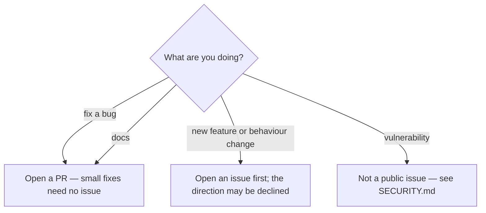

# Contributing

Thanks for taking the time to improve AIJIASU2API. This is a research project with a narrow
scope, and the rules below exist so that changes stay reviewable and claims stay checkable.

Read [DISCLAIMER.md](DISCLAIMER.md) and the [Use boundary](README.md#use-boundary) first. If your
change would make the project easier to use for unauthorised access, resale, or payment
processing, it is out of scope.

## Decide first



Small documentation fixes, typos, and test-only corrections can go straight to a pull request.
Anything that changes the API contract, authentication, the gate, the persistence format, or the
release pipeline needs an issue first so the direction is agreed before the work.

## One concern per PR

One PR changes one thing. Remove unrelated hunks even if CI is green. A PR that mixes a refactor
with a behaviour change is rejected: the reviewer cannot tell which hunk caused the failure, and
the history cannot be reverted cleanly.

## No credentials, no vendor artifacts

**Never commit credentials.** No account names, passwords, e-mail addresses, tokens, TOTP secrets,
session cookies, or hashes of any of them — not in code, reports, fixtures, issue text, or commit
messages. `.env`, `*.key`, `*.pem`, `state.json`, and `secrets.json` are ignored; keep it that way.

**Never commit vendor artifacts.** No installers, drivers, DLLs, packet captures, memory dumps, or
decompiled vendor code. Research captures that are retained must be synthetic or redacted. If a
change needs a sample to explain itself, describe it and cite a hash; do not attach the sample.

A diff containing either is closed without review.

## Evidence bar

Every factual claim in a PR, a doc, or a commit message cites a path, a command, or a URL. If you
did not run it, say so and mark it `[UNVERIFIED]` or `[INFERENCE]`. An unlabelled claim is treated
as false until checked. This applies to test counts, live behaviour, and "it works" statements
equally.

Do not copy a count from another document. Measure it or omit it.

## Tests

Run the suites for the tree you touched. The commands are the authority; this page deliberately
does not pin test counts, because a number written where it is not measured will rot.

```bash
# Daemon and emulator (daemon/go.mod replaces ajsproxy => ../emulator,
# so the two trees must be siblings)
cd daemon && go vet ./... && go test -race -count=1 ./...
cd ../emulator && go vet ./... && go test -race -count=1 ./...

# Dashboard
cd ../dashboard && npm ci && npm run verify:lockfile
npm test -- --pool=forks --maxWorkers=1
VITE_USE_MOCK=false VITE_API_BASE= npm run build

# SDKs
cd ../sdk/go && go test -race -count=1 ./...
cd ../sdk/ts && npm ci && npm test && npm run typecheck
```

Behaviour changes need a test that fails before the change and passes after it. A schema-only test
is not enough for an HTTP contract change: assert the status code and the response envelope the
daemon actually emits.

The dashboard suite runs serially in CI (`--pool=forks --maxWorkers=1`); timing-sensitive tests
fail on a loaded host when run in parallel. Keep new tests independent of wall-clock ordering.

## Generated files

The public docs mirror is generated from `docs/openapi.json` and `dashboard/src/docs/content.ts`.
Do not hand-edit:

- `dashboard/src/docs/reference.generated.ts`
- `dashboard/public/docs/*.md`
- `dashboard/public/llms.txt`

Change the source, then run `cd dashboard && npm run docs:gen`, and commit the regenerated
output. CI runs `npm run docs:gen -- --check` and fails on drift. If you changed
`docs/openapi.json`, keep `daemon/internal/api/openapi.json` in sync as well; a test enforces it.

## Security-sensitive paths

These paths run with the repository's trust boundary. A green CI run is not review for them:

- `daemon/internal/api/` — routing, RBAC, CSRF, scoped keys, tenant isolation.
- `daemon/internal/gate/` and `daemon/internal/runtime/` — gate admission, lease binding, relay.
- `daemon/internal/store/` — persistence, sealed secrets, backups.
- `deploy/production/` — nginx, systemd, nftables, the live topology.
- `.github/workflows/` — runs with repository tokens and publish permissions.
- `SECURITY.md`, `GOVERNANCE.md`, `CODEOWNERS` — intake and ownership.

Changes there need a reviewer who has read [SECURITY.md](SECURITY.md) and
[docs/RBAC.md](docs/RBAC.md), and a test that demonstrates the boundary. If you are unsure, open
an issue before writing code.

## Commits and pull requests

Use `type(scope): summary` in the imperative mood, for example `fix(gate): reject expired leases
at CONNECT` or `docs(api): correct the lease port example`. Types: `feat`, `fix`, `docs`, `test`,
`refactor`, `chore`, `security`.

- Explain **why** in the body, not only what changed.
- Reference the issue or ticket (`AJS-123`) when one exists.
- **No AI attribution.** Do not add `Co-Authored-By` trailers naming an AI, "Generated with"
  lines, or tool signatures. You are responsible for the change.
- Keep the diff focused; do not reformat unrelated files.

The pull request template asks what you verified yourself. Answer it literally. If a claim came
from an external report or another analysis, say which parts you reproduced.

## Review and merge

The maintainer reviews every change; see [GOVERNANCE.md](GOVERNANCE.md) and
[.github/CODEOWNERS](.github/CODEOWNERS). A PR is merged when:

- the concern is in scope and the diff is limited to it;
- the relevant suites pass and the commands are quoted in the PR;
- the evidence bar is met;
- docs and generated files are updated or the PR states why they are unchanged;
- security-sensitive changes carry a boundary test.

Review is a conversation, not a vote. The maintainer may decline a change that is correct but out
of scope, and will say why.

## Documentation

Documentation is part of the change. Update the file that owns the fact, not a copy of it:

- Behaviour and API usage: [docs/API-GUIDE.md](docs/API-GUIDE.md).
- Contract: [docs/openapi.json](docs/openapi.json), then regenerate the mirror.
- Release contents: [CHANGELOG.md](CHANGELOG.md).
- Direction and closed surfaces: [ROADMAP.md](ROADMAP.md).
- Operator procedures: [deploy/README.md](deploy/README.md) and
  [deploy/packaging.md](deploy/packaging.md).

Do not add a second copy of a fact that already has an authority. Link to the authority instead.

## Security reports

Do not open a public issue for a vulnerability, and do not include an exploit in a PR. Follow
[SECURITY.md](SECURITY.md). If your change fixes a reported vulnerability, say so in the PR
without reproducing the exploit against a live service.

## Licence and conduct

Contributions are accepted under the MIT licence in [LICENSE](LICENSE). By opening a PR you confirm
you have the right to submit the change under that licence. Participation is covered by
[CODE_OF_CONDUCT.md](CODE_OF_CONDUCT.md).
