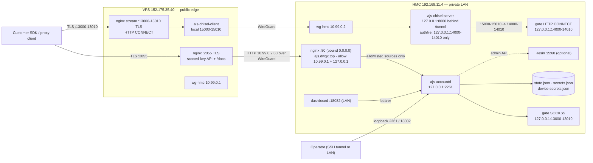

# Architecture

Status: current for `v0.1.0-pre.2` (release prep, 2026-10-29; tag not yet pushed). This page
describes what runs, where the trust boundaries are, and which parts of the tree are actually
deployed. It is not a design proposal: anything marked *live* was observed read-only on
2026-10-27/28 or applied to the live hosts on 2026-10-28, and is recorded in
[`deploy/production/README.md`](../deploy/production/README.md#live-deployment-2026-10-27),
[`deploy/live/README.md`](../deploy/live/README.md) (the as-built configs) and the release's
read-only edge audit (2026-10-28).

## Two planes, one daemon

`ajs-accountd` is a single Go process with two planes in one binary:

- **Control plane** — the admin/scoped-key JSON API on `127.0.0.1:2261` (`AJS_LISTEN`), the
  operator dashboard, the JSON state snapshot, and the optional scheduler/webhook/backup
  surfaces. Everything here is bearer-authenticated.
- **Data plane** — one loopback gate per live vendor session: SOCKS5 on
  `127.0.0.1:13000-13010` and, when `AJS_GATE_HTTP=1`, HTTP `CONNECT` on
  `127.0.0.1:14000-14010` (`gatePort + AJS_GATE_HTTP_OFFSET`, default offset `1000`). The
  gate re-checks the scoped key, lease, account grant, user allowlist and quota at `CONNECT`.
  The daemon never binds a public address.

The public HTTPS CONNECT edge is nginx `stream`, not the daemon. It terminates TLS and relays
bytes, so `Proxy-Authorization` reaches the gate untouched and never lands in an nginx log.

## Live topology (2026-10-27 cutover, hardened 2026-10-28)



Facts behind the drawing, from the read-only live record and the 2026-10-28 hardening pass:

| Hop | Transport | Authentication |
|---|---|---|
| client → VPS `:2055` | TLS 1.2/1.3 (ECDHE AEAD only), cert `ajs.dwgx.top` (SAN `gate.dwgx.top`); 120 r/m burst 60 per IP, 20 connections/IP, 400 total, 2 MB body, `server_tokens off` | scoped key `ajs_sk_…` at the daemon; the edge injects no credential |
| VPS → HMC nginx `:80` | **plaintext HTTP inside WireGuard** (`10.99.0.1` → `10.99.0.2`) | WireGuard peer key, then the vhost's `allow 10.99.0.1; allow 127.0.0.1; deny all;`; no end-to-end TLS/mTLS |
| VPS stream → chisel local `:15000-15010` | TLS at the edge, then chisel over WireGuard | chisel account whose authfile allows only the anchored forwards `127.0.0.1:14000-14010` |
| chisel → HMC `:14000-14010` | loopback HTTP CONNECT | the gate's own RFC 1929 check |
| HMC LAN → `:18082` (dashboard) | plaintext HTTP on `192.168.11.0/24` | operator Basic; two SSE routes inject a server-side admin bearer, source-IP allowlisted; **live host has no strict RBAC** |
| HMC loopback → `:2261` | plaintext HTTP on `127.0.0.1` | admin bearer; **live host has no strict RBAC** |

The daemon no longer listens on a LAN address: since 2026-10-28 `AJS_LISTEN=127.0.0.1:2261`,
and the HMC-side internal vhost is the only thing that talks to it. That vhost proxies `/v1/`
and `/metrics` to `127.0.0.1:2261`, but only for `10.99.0.1` (the VPS WireGuard peer) and
`127.0.0.1`; every other source is denied, so a LAN `/v1/whoami` answers `403`. The 41-path
allowlist is still enforced at the VPS, not at the origin, so a caller *inside* the allowed
sources reaches the whole `/v1/` namespace and only the daemon's auth/RBAC stops it. The process
still runs as root and without `AJS_RBAC_STRICT`, so compatibility mode keeps accepting the
legacy shared bearer and a local holder of it has the full admin surface. See
[`docs/SECURITY-MODEL.md`](SECURITY-MODEL.md#the-edge-allowlist-is-the-enforcement-point).

## Self-hosted kit topology (reviewed, reproducible)

The reviewed production kit in [`deploy/production/`](../deploy/production/README.md) is a
different, reproducible shape: no VPS, no chisel, no WireGuard.

```text
customer ── TLS :443 ──> nginx api.example.com ──> 127.0.0.1:2261
customer ── TLS :13000-13010 ──> nginx stream ──> 127.0.0.1:14000-14010
operator ── SSH/VPN ──> nginx 127.0.0.1:8443 ──> 127.0.0.1:2261
portal  ── TLS :443 ──> nginx panel.example.com ──> static bundle (+ /v1/portal/* when enabled)
```

The kit's gate map hard-codes `port + 1000` (`13000-13010` → `14000-14010`) and its API
vhost publishes the 54 scoped operations on 41 paths. The live VPS instead uses a
hand-written vhost — captured, not templated, in
[`deploy/live/`](../deploy/live/README.md) — and a chisel forward map
(`13000-13010` → `15000-15010`) whose authfile is anchored to `127.0.0.1:14000-14010`. That
divergence is the single largest reproducibility gap in this release and is stated in
[`deploy/production/README.md`](../deploy/production/README.md#live-deployment-2026-10-27).

## Components

| Component | Path | Role in `v0.1.0-pre.2` |
|---|---|---|
| `ajs-accountd` | `daemon/` | control plane, gate, scheduler, webhooks, backup; Go 1.26 module, JSON snapshot |
| dashboard | `dashboard/` | operator console (15 admin routes) and the public `/docs` bundle; same JS for portal and admin, only the nginx route surface differs |
| production kit | `deploy/production/` | nginx vhosts, stream map, hardened unit, firewall, `check.sh` |
| live as-built | `deploy/live/` | byte-for-byte copies of the configs serving the live hosts on 2026-10-28; reference only, no script applies them |
| packaging | `deploy/package.sh` | three platform binaries, dashboard tarball, manifest, SHA-256 sums, deploy kit |
| SDKs | `sdk/go`, `sdk/ts` | hand-written clients for the admin API (not the gate) |
| emulator | `emulator/` | offline Tier-2 `FV` protocol model; never deployed |
| Resin | external | optional vendor-session publisher on `127.0.0.1:2260`; empty token disables it |

Closed/removed surfaces: two experimental subsystems from earlier milestones (a credential
store and an unused node-controller seam) were deleted in `e9e546e`. Nothing in this release
reads their settings or serves them; treat any document that describes them as current as
stale.

## Ports

| Port | Bind | Process | Exposure |
|---|---|---|---|
| `2261` | `127.0.0.1` in the kit and on the live HMC (since 2026-10-28) | `ajs-accountd` | loopback only; reached from outside only through the HMC vhost's `10.99.0.1`/`127.0.0.1` allowlist |
| `2262` | `127.0.0.1` | optional daemon TLS listener | loopback, off by default |
| `2260` | `127.0.0.1` | Resin | loopback, optional |
| `8443` | `127.0.0.1` | nginx admin vhost | loopback/VPN only |
| `13000-13010` | `127.0.0.1` | gate SOCKS5 | loopback only, never published |
| `14000-14010` | `127.0.0.1` | gate HTTP CONNECT | loopback; published only through nginx stream |
| `18081` | `127.0.0.1` | compose dashboard | loopback |
| `18082` | LAN-reachable on the live HMC | live dashboard | LAN on the live host (unchanged by the 2026-10-28 hardening) |
| `2055` | VPS public IPv4 | nginx API/docs vhost | public, live |
| `13000-13010` | VPS public IPv4 | nginx stream gate | public, live |
| `15000-15010` | VPS loopback | chisel client forwards | loopback, live |
| `8080` | HMC `127.0.0.1` | chisel server | loopback, published only via HMC nginx `/tunnel` |
| `80` | HMC `0.0.0.0` (live) | HMC nginx internal vhost | bound wildcard, but access-controlled: only the WireGuard peer `10.99.0.1` and `127.0.0.1` pass; every other source is denied |

## Storage

- **JSON snapshot** at `$AJS_STATE_FILE` (default `$AJS_STATE_DIR/state.json`), loaded before
  the listener starts, saved every `AJS_SNAPSHOT_INTERVAL` (default 30 s) and on shutdown.
  There is no SQLite: `docs/PANEL.md` §6 is a design baseline, not the implementation.
- **Sealed account passwords** in `$AJS_STATE_DIR/secrets.json` with `AJS_MASTER_KEY`
  (AES-256-GCM). Losing the key makes existing sealed values unrecoverable.
- **Device identities** in `$AJS_STATE_DIR/device-secrets.json` under an HKDF-SHA-256 key
  derived from `AJS_MASTER_KEY`.
- **Append-only histories**, all in memory and in the snapshot, all bounded: request log
  10,000 rows, audit 1,000 events, event ring 500, lab log ring 2,000.
- **State journal** (`AJS_JOURNAL=1`) is opt-in; the snapshot remains the default and the
  journal's recovery path is offline-tested only.

## Gate allocation

Gates allocate upward from `13000`, one port per live node, bounded by the vendor's active
data sessions and `AJS_NODE_LIMIT` (default `1`). The public stream map is static: the kit
publishes 11 ports (`13000-13010`), and a node that lands on `13011+` has no public edge.
A switch that rebinds a lease moves its `connection.port`; a client must re-read
`GET /v1/leases/{id}` after a switch.

## Numbers

Every count below is reproduced by the command beside it; none is hand-maintained.

```bash
# contract: 120 paths, 148 operations, 200 schemas
python -c "import json;d=json.load(open('docs/openapi.json'));print(len(d['paths']),sum(1 for p in d['paths'].values() for m in p if m in ('get','post','put','patch','delete')),len(d['components']['schemas']))"

# scoped surface: 54 operations on 41 paths
python -c "import json;d=json.load(open('docs/openapi.json'));ops=[o for p in d['paths'].values() for m,o in p.items() if m in ('get','post','put','patch','delete')];print(sum(1 for o in ops if 'x-required-scope' in o and o['x-required-scope']!='admin'), len({p for p,i in d['paths'].items() for m,o in i.items() if m in ('get','post','put','patch','delete') and 'x-required-scope' in o and o['x-required-scope']!='admin'}))"

# public gate map: 11 stream servers
grep -c '^server {' deploy/production/nginx/streams-available/ajs-gate.conf

# operator console: 15 admin routes (the 16th leading-slash route is /docs)
sed -n '/<Route element={<AdminLayout/,/^              <\/Route>/p' dashboard/src/App.tsx | grep -c '<Route path="/'
```

## Pointers

- [`docs/OPERATIONS.md`](OPERATIONS.md) — build, deploy, backup, rotation, rollback
- [`docs/SECURITY-MODEL.md`](SECURITY-MODEL.md) — boundaries and known limitations
- [`docs/RELEASE.md`](RELEASE.md) — tags, gates, artifacts, checksums
- [`deploy/production/README.md`](../deploy/production/README.md) — reviewed kit and live record
- [`deploy/live/README.md`](../deploy/live/README.md) — as-built configs serving the live hosts on 2026-10-28
